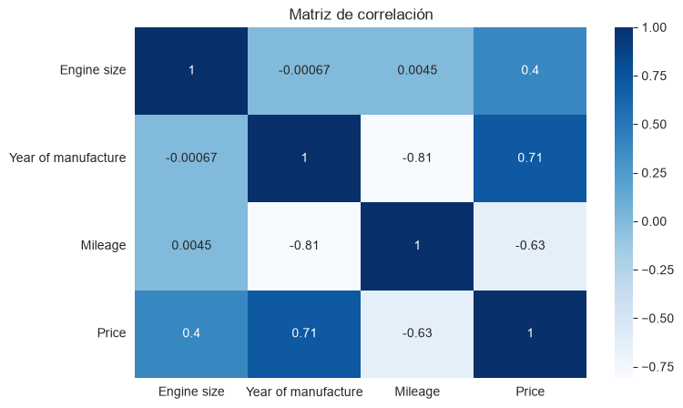

Análisis Exploratorio del Mercado Automotriz

Descripción

Proyecto de análisis exploratorio de datos realizado con Python para identificar patrones y tendencias en el mercado automotriz.

Objetivos

Analizar la distribución de vehículos por fabricante.
Estudiar la relación entre precio y kilometraje.
Comparar precios entre fabricantes.
Identificar variables que influyen en el valor de los vehículos.
Dataset
El conjunto de datos contiene información sobre vehículos, incluyendo fabricante, modelo, tamaño de motor, tipo de combustible, año de fabricación, kilometraje y precio.

Herramientas utilizadas
Python
Pandas
NumPy
Matplotlib
Seaborn
Jupyter Notebook

Principales hallazgos

Ford y Volkswagen presentan la mayor cantidad de vehículos registrados.

Precio promedio por fabricante

Porsche posee el precio promedio más elevado.

Existe una correlación negativa fuerte entre kilometraje y precio (-0.63).
El año de fabricación muestra una correlación positiva fuerte con el precio (0.71).
Los vehículos más recientes tienden a conservar mejor su valor de mercado.

Autor
Román Vicente Lemos

Técnico Universitario en Ciencia de Datos `